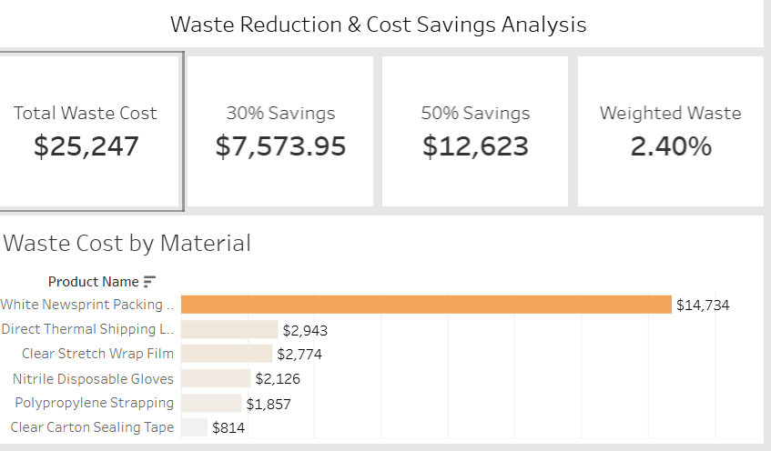

# Factory Waste Reduction & Cost Savings Analysis

## Dashboard Preview

The Tableau dashboard shows total waste cost, savings opportunities, material-level waste, and monthly trends.


## Business question

**How much money could a packaging factory save by reducing material waste?**

This Databricks and Tableau portfolio project follows packaging materials from daily use and waste events through cost-based savings scenarios. It identifies the materials, machine lines, shifts, and waste reasons that should be investigated first.

## Key results

| Analysis period | Recorded waste cost | Savings at 30% reduction | Savings at 50% reduction |
| --------------- | ------------------: | -----------------------: | -----------------------: |
| 2025 full year  |          $20,014.50 |                $6,004.35 |               $10,007.25 |
| 2026 Q1         |           $5,232.00 |                $1,569.60 |                $2,616.00 |

Packing paper (`BNP1290`) is the main focus material. A practical one-time target of saving **two paper rolls at each of seven lines** represents **14 rolls × $39.50 = $553** in potential savings. Actual realized savings depend on whether lower waste leads to lower purchasing requirements.

## Tools

- Databricks SQL and Unity Catalog Volumes
- Medallion architecture: Bronze → Silver → Gold
- Tableau for the dashboard
- GitHub for project documentation and version control

## Dataset

The project uses four CSV sources for each year:

| Source                  | Purpose                                                                      |
| ----------------------- | ---------------------------------------------------------------------------- |
| `product_master.csv`    | Material descriptions, unit costs, vendors, and operating assumptions        |
| `daily_consumption.csv` | Material issued, used, returned, and processed by date, line, shift, and SKU |
| `waste_log.csv`         | Recorded waste quantities and reasons                                        |
| `purchase_orders.csv`   | Purchase quantities, material prices, freight, and vendors                   |

Data coverage is January–December 2025 and January–March 2026. The project data is synthetic and intended for portfolio learning.

## Project flow

1. Upload the `data/bronze/2025` and `data/bronze/2026` folders to a Databricks Volume.
2. Create one Bronze table for each source and year.
3. Standardize fields and combine transactional years with `UNION ALL` in Silver.
4. Join usage, waste, and unit cost in Gold after aggregating waste to the usage grain.
5. Calculate waste cost and 30% / 50% reduction scenarios.
6. Connect the Gold Tableau extract to a dashboard.

See [SQL run order](sql/RUN_ORDER.md) for the exact execution sequence.

## Repository structure

```text
manufacturing_cost_reduction/
├── data/
│   ├── bronze/             # Source CSVs organized by 2025 and 2026
│   ├── silver/             # Cleaned, standardized CSV examples
│   └── gold/               # Analysis-ready and Tableau-ready outputs
├── docs/                   # Data dictionary, Databricks and Tableau guides
├── notebooks/              # Exploration and Databricks notebook exports
├── sql/                    # Databricks SQL scripts in execution order
├── .gitignore
└── README.md
```

## Data-quality rules

- Every operational SKU must exist in `product_master`.
- Negative material quantities are invalid.
- Waste reasons are standardized in Silver while retaining the original label.
- Waste is aggregated by date, facility, line, shift, and SKU **before** joining to consumption. This prevents duplicated waste cost.
- Reconciliation rule: `issued = used + returned to stock + recorded waste`.

## Important definitions

- **Waste cost:** `units_wasted × standard_unit_cost`
- **Consumed units:** `units_used + units_wasted`
- **Potential gross savings:** `waste_cost × reduction percentage`
- **Cost-weighted waste rate:** `waste_cost ÷ consumed_cost`

Use cost-weighted measures when comparing materials with different units, such as paper rolls and tape boxes.

## Dashboard questions

- Which material creates the most waste cost?
- Which machine line and shift have the greatest waste cost?
- Which waste reasons are most common and most expensive?
- How much could the factory save at 30% and 50% waste reduction?
- What is the savings impact of reducing two packing-paper rolls per line?

## Limitations

Savings are potential gross savings based on standard cost. The data does not include a confirmed waste-reduction intervention, complete inventory balances, or implementation costs. Therefore, this project does not claim verified net savings.


